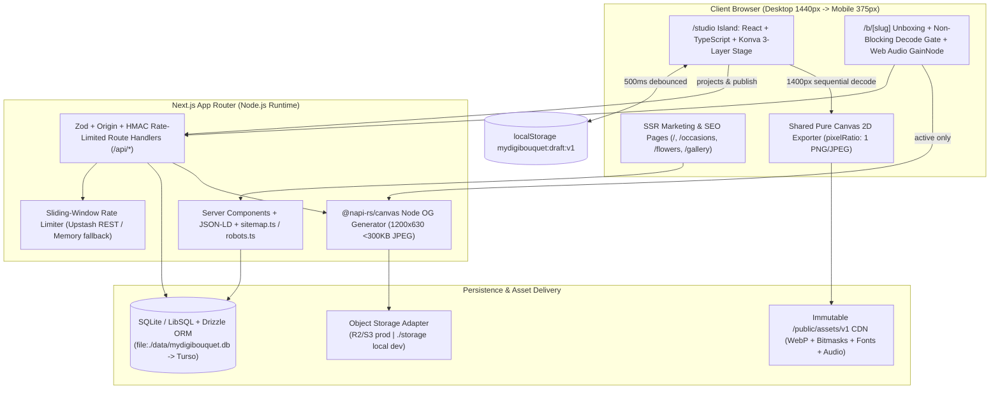

# System Architecture Specification (`architecture.md`)

**Version:** `1.1 (Peer-Reviewed & Hardened — Engineering, UI/UX, SEO & QA Ready)`  
**Lead Author:** Senior Software Architect & Full-Stack Technical Lead  
**Canonical Inputs:** [SPEC.md](file:///Users/vaibhavborkar/mydigibouquet.com/SPEC.md), [Product Requirements](file:///Users/vaibhavborkar/mydigibouquet.com/docs/research/product-requirements.md), [DESIGN_SYSTEM.md](file:///Users/vaibhavborkar/mydigibouquet.com/docs/DESIGN_SYSTEM.md), [studio-interaction-spec.md](file:///Users/vaibhavborkar/mydigibouquet.com/docs/design/studio-interaction-spec.md), [page-specifications.md](file:///Users/vaibhavborkar/mydigibouquet.com/docs/design/page-specifications.md)

---

## 1. Existing Workspace Inspection & Constraints

- **Workspace Audit:** Direct inspection confirms `/Users/vaibhavborkar/mydigibouquet.com` contains only documentation files (`SPEC.md`, `STATE.md`, `docs/*`) with no existing `src/`, `package.json`, or app code. Existing specification deliverables must remain preserved.
- **Verified Host Environment:** macOS with `Node v26.13.0`, `npm 11.20.0`, `Git 2.50.1`, `Python 3.9.6`, and `/usr/bin/sqlite3`. `psql`, `docker`, `ffmpeg`, and `ImageMagick` (`magick`/`convert`) are **not** installed locally.

---

## 2. High-Level System Architecture



---

## 3. Frontend Architecture (`Next.js App Router` + `TypeScript Strict` + `Tailwind CSS`)

### 3.1 Rendering, Bundle & SEO Isolation Boundaries
1. **Marketing & SEO Routes (`/` · `/occasions/**` · `/flowers/**` · `/gallery` · `/about` · `/privacy` · `/terms`):**
   - Pure React Server Components (RSC) consuming versioned catalog/editorial data with **zero Konva JS chunk** and **only `fonts-base.ts` (`Cormorant Garamond` `400/500/600` normal+italic + `Plus Jakarta Sans` `400/500/600`)** (`LCP < 2.0s`, `CLS < 0.05`, `/` First-Load JS `< 95 KB` gz). Note: `"Open Sample Letter"` peek drawer on `/` strictly uses `fonts-base.ts`.
   - Configures **`metadataBase: new URL("https://mydigibouquet.com")`** in `app/layout.tsx` so canonical URLs resolve cleanly.
   - Emits route-specific XSS-escaped (`<` -> `\u003c`) JSON-LD cleanly mapped per route:
     - `/` -> `Organization` + `WebApplication` + `FAQPage` (matching the visible 5-item accordion 1:1)
     - `/studio` (clean canonical URL) -> `WebApplication`
     - `/occasions/[slug]` & `/flowers/[slug]` -> `BreadcrumbList` + `Article`/`DefinedTerm` + `ImageObject` + 1:1 visible `FAQPage`
     - `/gallery` -> `CollectionPage` + `CreativeWork`
   - `src/app/sitemap.ts` enumerates all **27 canonical indexable V1 routes** (`/`, `/studio`, `/occasions` + 8, `/flowers` + 12, `/gallery`, `/about`, `/privacy`, `/terms`) with `/assets/v1/editorial/*` image entries (`images: [...]`), strictly excluding `/b/*` and `/studio?*`.
   - `src/app/robots.ts` explicitly sets **`allow: ['/', '/b/', '/api/og/']`** (never disallowing `/b/`, so crawlers observe `noindex, nofollow`!) and **`disallow: ['/api/projects/', '/api/preferences/', '/api/report/', '/api/media/', '/receipt/']`**.
   - Dedicated editorial showcase assets live cleanly in `public/assets/v1/editorial/*` (`480w`/`960w` WebPs) rendered via `<Image unoptimized />` with fixed dimensions so Hero & species spotlights preserve `immutable` caching with zero double-encoding or thumbnail upscaling.
2. **Studio Route (`/studio`):**
   - Clean `/studio` remains `index, follow` (`canonical: https://mydigibouquet.com/studio`); parameterized URLs (`/studio?preset|occasion|stem|replyTo=` or any non-canonical query) emit `canonical: https://mydigibouquet.com/studio` + `<meta name="robots" content="noindex, follow" />`. `?replyTo=` is parsed strictly client-side (never reflected into SSR `<title>`, `<meta>`, or HTML).
   - `KonvaStage` loads dynamically via `next/dynamic({ ssr: false })`. `fonts-script.ts` (`Alex Brush`) and `fonts-literary.ts` (`Lora` normal+italic) load **strictly in separate leaf font modules** imported inside `/studio` and conditionally per selected pairing on `/b/[slug]`.
   - Applies dark-mode tokens (`--dark-surface`, `--dark-text-*`, `--dark-border #737970`, dual-tone selection outline) immediately on stage wrappers and stationery surfaces via `[data-surface="slate"]`.
3. **Recipient Unboxing Route (`/b/[slug]`):**
   - Declares `export const dynamic = "force-dynamic";` + `Cache-Control: private, no-store` so moderated/hidden gifts never serve stale edge HTML; returns true **HTTP `404`** when missing or moderated (`hidden`/`deleted`), emits `X-Robots-Tag: noindex, nofollow`, `<meta name="robots" content="noindex, nofollow">`, and ensures **`Referrer-Policy: no-referrer`** on `/b/:path*` sits **after** `/(.*)` in `next.config.ts` header rules (same privacy headers applied cleanly to V1.1 `/receipt/[token]`).
   - Emits deterministic privacy-safe link metadata: `<title>` & `og:title` = `"A thoughtful floral arrangement awaits | MyDigiBouquet"` when `hideNamesInPreview` or PIN locked, else `"A Bouquet for [Recipient] from [Sender]"` (using safe blank fallbacks), `og:description` = `"Tap to untie the ribbon and view your floral keepsake."` (never note text!), `og:image:width = 1200`, `og:image:height = 630`, `twitter:card = "summary_large_image"`.
   - **Strict RSC Prop Sanitizer (Anti-Leak):** Before serializing Server Component props (`__next_f`), the route strips `card.message` and V1.1 `media` whenever `has_pin = 1`, AND strips `recipientName`/`senderName` whenever `hideNamesInPreview = 1`—fetching unredacted payloads on unlock/unseal via `GET /api/bouquets/[slug]`.
   - **Non-Blocking LCP & Decode Gate:** SSR HTML renders the priority closed envelope/backdrop (`5:6` framed artwork, never `1200×630` OG crop) immediately (`LCP < 2.0s`); client hydration executes `Promise.allSettled` capped by a **`3000ms` timer**, reveals `Tap to Open Your Bouquet`, invokes synchronous audio playback + envelope crossfade + tap beacon (`POST /api/bouquets/[slug]/open`), renders post-reveal interactive views on `renderBouquetToContext2D` (`700px` `studio` WebPs on static `<canvas>` — zero Konva chunk on `/b/[slug]`, preserving Tier 2 occlusion, refraction, and front-drape parity!), and shifts keyboard focus cleanly to the revealed letter heading (`tabIndex={-1}`).

### 3.2 Directory Structure (`src/`)

```text
src/
├── app/
│   ├── layout.tsx                    # Root layout: metadataBase + Warm Atelier tokens + fonts-base.ts ONLY
│   ├── robots.ts / sitemap.ts        # Crawl allow (/ & /b/) + 27-URL ImageObject sitemap
│   ├── (marketing)/                  # /, /about, /privacy, /terms (pure RSC, visible / FAQ)
│   ├── (seo)/occasions/              # /occasions, /occasions/[slug] (8 guides) + not-found.tsx
│   ├── (seo)/flowers/                # /flowers (28 SKUs), /flowers/[slug] (12 species #color) + not-found.tsx
│   ├── (seo)/gallery/page.tsx        # Curated presets showcase (CollectionPage JSON-LD)
│   ├── studio/page.tsx               # 4-Step Studio workbench shell + dynamic Konva island
│   ├── b/[slug]/page.tsx + not-found.tsx  # force-dynamic unboxing + sanitized RSC props + Decode Gate
│   └── api/                          # Zod + Origin + HMAC rate-limited Node routes
├── engine/
│   ├── types.ts                      # Strict BouquetSceneV1, CatalogManifest, 8 OccasionSlug, UI copy constants
│   ├── validation.ts                 # Zod schemas, Intl.Segmenter + UTF-8 byte caps, Bidi strip, Vessel rules
│   ├── arranger.ts                   # Auto-layouts (Classic Round, Airy Garden, Cascading, Minimalist)
│   ├── hit-mask.ts                   # 160px offscreen alpha bitmask loader + scaled screen-space hit-slop
│   ├── konva-stage.ts                # StaticBack, ActiveDrag (+front-drape lift), StaticFront, SelectionOverlayLayer
│   └── canvas-renderer.ts            # Pure Canvas 2D compositor (3-tier shadows, Slate dark inks, Export, OG, /b reveal)
├── components/
│   ├── ui/                           # AtelierIcons (inline 1.5px SVG), AtelierButton, ToastBanner, ModalSheet
│   ├── studio/                       # StepHeaderBar, BotanicalTile, FilterPillBar, InspectorPanel, LayerStrip, CardEditor
│   └── recipient/                    # EnvelopeReveal, StationeryCardPreview, AudioTrackBar, MeaningDrawer
├── lib/
│   ├── fonts-base.ts                 # Root fonts: Cormorant Garamond (normal/italic) & Plus Jakarta Sans
│   ├── fonts-script.ts               # Lazy leaf: Alex Brush (studio + calligraphic /b/[slug] only)
│   ├── fonts-literary.ts             # Lazy leaf: Lora (normal/italic) (studio + calligraphic/warm-literary only)
│   ├── card-layout.ts                # Virtual 640x800 wrapCardMessage() + name fit + font-load re-measure guard
│   ├── draft-storage.ts              # localStorage mydigibouquet:draft:v1 (500ms debounce, QuotaExceeded safe)
│   ├── security.ts                   # Trusted-IP resolver, HMAC IP pepper, Origin CSRF, timingSafeEqual, async scrypt
│   ├── rate-limit.ts                 # Upstash REST sliding window + memory fallback
│   ├── storage.ts                    # StorageAdapter (R2/S3 prod | local ./storage w/ base62-safe validation)
│   └── audio-engine.ts               # Synchronous tap-bound Web Audio GainNode controller + visibility pause
└── db/
    ├── index.ts                      # Drizzle + @libsql/client enforcing PRAGMA foreign_keys = ON per connection
    ├── schema.ts                     # Canonical 8 tables (`file:./data/mydigibouquet.db` dev -> Turso prod)
    └── seed.ts                       # Idempotent catalog/template seeder
```

### 3.3 State Management & Undo/Redo Architecture
`/studio` mounts `StudioSceneProvider` using **React `useReducer` + Context** (zero Redux/Zustand overhead):
- `SceneDocState`: `{ present: BouquetSceneV1, past: BouquetSceneV1[], future: BouquetSceneV1[] }` (`max 30` snapshots).
- `UiSessionState`: `selectedStemId`, `activeStep` (`1..4`), `mobileSheetMode` (`collapsed | expanded`), `isExporting`, `lastPublishedSlug` (**immediately invalidated on any scene mutation** with shared constant copy *"Bouquet updated — Generate Updated Link"*), `draftConflictPrompt`, `beforeunload` dirty guard.
- Konva drags mutate live node transforms at `60fps` and commit one snapshot on `dragend` / slider `onChangeEnd` (held arrow keys debounce commits at `400ms`).

---

## 4. Bouquet Creation Engine Evaluation & Selection

| Criterion | **Fabric.js (`fabric` v6)** | **Imperative Konva.js (`konva` direct, no `react-konva`)** | **Native Canvas 2D (from scratch)** | **Native DOM SVG** |
| :--- | :--- | :--- | :--- | :--- |
| **Bundle & React 19 Fit** | ~110 KB gz; stateful OOP canvas owns objects outside React | **~55 KB gz**; zero `react-reconciler` peer mismatch in React 19 / Next 15+ | Requires ~1,500+ LOC scene graph & pointer gesture machinery | High DOM node count degrades drag performance on mobile |
| **Drag-and-Drop (`60fps`)** | Built-in, heavy default bitmap caching unless suppressed | **`StaticBack` / `ActiveDrag` (+ front-drape drag slot) / `StaticFront` repaints only 1 dragged node on `dragmove`** | Manual dirty-rect compositor required | CSS filter thrashing across 15 overlapping raster `<image>` nodes |
| **Rotation & Scaling** | Intrusive 9-handle box chrome overlaps neighboring petals on `375px` mobile | **Clean collar-pivot transforms; top `SelectionOverlayLayer` renders dual-tone frame + single unoccluded `>=44px` mobile rotation knob** | Manual affine matrix inverse transforms | Safari SVG `<g>` transform-origin quirks |
| **Layer Ordering & Clipping** | Flat linear object list | **Explicit layer partitions** isolate Tier 2 interior pocket occlusion, Clear Glass refraction, `allowFrontDrape`, and bow | Manual multi-pass composite loop | Z-order re-insertion causes WebKit frame flickers |
| **Object Selection & Complex Alpha** | `perPixelTargetFind` caches full-res bitmaps in memory (iOS Jetsam hazard) | **Custom `hitFunc` samples pre-computed `160px` bitmasks (`<1.8 MB` RAM, zero `.cache()`, scaled mobile slop `12 / (stageScale * stem.scale)`)** | Must build custom pixel-hit matrix transform lookup | Transparent PNG bounding boxes block stems behind |
| **Touch Interactions (`375px`)** | 2-finger controls conflict with viewport scroll/zoom gestures | **Single-finger `touch-action: none` drag** + `44×44px` external sliders avoid pinch conflicts | Complex pointer capture bookkeeping | Poor touch precision under rotated transparent images |
| **High-Resolution Exports** | Viewport resize / headless clone distortion risk | **Shared Canvas 2D compositor** (`renderBouquetToContext2D`) renders fixed `pixelRatio: 1` PNGs, Clear Glass caustic + dark `--dark-text-*` inks on `Slate`! | Same Canvas 2D pipeline | `<foreignObject>` WebKit tainting & missing SVG filter parity |
| **Verdict** | Rejected | **SELECTED** (Best mobile performance, precision masking, tiny footprint) | **Co-Selected strictly for Headless Export & Node OG** | **Selected strictly for crisp UI icons & clip polygons** |

---

## 5. Performance Architecture & Budgets

- **Homepage & SEO (`/`, `/occasions/**`, `/flowers/**`, `/gallery`):** Zero Konva runtime, `< 95 KB` gz First-Load JS, curated `editorial/*.webp` showcase images (`<Image unoptimized />` bypassing double-transcode), `LCP < 2.0s`, `CLS < 0.05`. Client interactive `INP < 150ms` is verified in Playwright via `web-vitals` scripted interaction (`TBT < 200ms` verified via headless Lighthouse).
- **Client Export (`Step 4`) & Card Parity:** Exact **`pixelRatio: 1`** fixed canvas outputs (`1600×1600`, `1080×1920`, `1440×1800`) sequentially decoding deduplicated `1400px` `export`-tier cutouts (`700px` `studio`/JPEG `0.92` automatic low-memory fallback). Whenever `tableSurfaceId === "slate"` (`#262B27`), `canvas-renderer.ts` switches overlay greeting/colophon/OG inks cleanly to `--dark-text-primary` (`#F5F2EB`) and `--dark-text-muted` (`#A9A59B`). `StationeryCardPreview` scales `640×800` via CSS `transform: scale(...)` inside a matched `aspect-[4/5]` box, renders `wrapCardMessage()` `lines[]` with `white-space: pre`, awaits `document.fonts.load(...)` on pairing changes (preventing FOUT wrap jumps), and auto-fits 40-grapheme names cleanly inside `486px`.
- **Same-Origin Assets & Cache Headers:** All `/assets/v1/*` files serve strictly from same-origin paths (`Cache-Control: public, max-age=31536000, immutable`), eliminating Safari cross-origin canvas tainting.

---

## 6. Security, Privacy & CSP Architecture

1. **Trusted Proxy IP & HMAC Privacy (`security.ts`):** `getTrustedClientIp` reads strictly platform-verified edge headers (`cf-connecting-ip`, `x-vercel-forwarded-for`, trusted single-proxy `x-real-ip` — never raw `x-forwarded-for`), hashing IPs exclusively via **`HMAC-SHA256(SERVER_IP_PEPPER, ip)`** so `2^32` IPv4 scans cannot reverse reporter or rate-limit IPs.
2. **Origin / CSRF & Cookie Signing:** All cookie-bearing or `multipart/form-data` mutations require exact `Origin` / `Sec-Fetch-Site === "same-origin"` validation. Signed cookies (`mydb_pref_token`, `mydb_unlock_{slug}`) use `COOKIE_SIGNING_SECRET` (`HMAC-SHA256`), `HttpOnly`, and strict flags. PIN verification uses **async `crypto.scrypt`** (`N=16384, r=8, p=1`, non-blocking!) with both `(slug, IP)` (`5 fails / 15m`) and `slug` (`25 fails / 1h`) cooldowns.
3. **Hardened Storage & Upload Security:**
   - `StorageAdapter` key validation matches strictly **`^[a-zA-Z0-9][a-zA-Z0-9/_-]{0,120}\.(webp|jpg|m4a|mp3|webm)$`** (allowing uppercase base62 slugs cleanly while blocking `..`, `//`, leading `/`, `\`, and null bytes with `path.resolve` containment check locally).
   - Client V1.1 Polaroid uploader accepts `<= 5 MB` raw photos and Canvas-shrinks them to `<= 2 MB` WebP/JPEG (`EXIF` stripped). Server `commit` inspects `headObject()` first, rejects non-JPEG/WebP formats (blocking **SVG XSS**!), and **unconditionally re-encodes** via `sharp` stripping all metadata chunks (`EXIF/XMP/ICC`).
   - V1.1 Voice upload verifies `ftyp` at **byte offset 4** (`M4A /M4B /mp42/isom` only), MP3 (`ID3`/`0xFFE0`), or WebM (`1A 45 DF A3`), parses duration (`<= 45s`) in pure JS, and stores non-executable UUID keys (`X-Content-Type-Options: nosniff`).
4. **Content Security Policy (`next.config.ts`):** Notice App Router compatibility: emits nonce-based or strict Next-compatible `script-src` alongside **`img-src 'self' data: blob:`** (required for Step 4 WebView keepsake modal + Canvas previews), **`media-src 'self' blob:`** (audio playback), **`style-src 'self' 'unsafe-inline'`** (Tailwind/Next inline style runtime), **`frame-ancestors 'self'`**, `object-src 'none'`, and zero third-party ad/tracker origins.

---

## 7. Zero-Bloat Dependency Ledger

| Layer | Adopted Package | Purpose | Explicitly Omitted |
| :--- | :--- | :--- | :--- |
| **Framework & UI** | `next`, `react`, `react-dom`, `tailwindcss`, `typescript` | App Router, SSR, Tailwind tokens, strict typing | `lucide-react` (custom 1.5px inline SVG icons) |
| **Canvas Stage** | `konva` (`~55 KB` gz) | Imperative 3-layer studio stage + `160px` `hitFunc` | `react-konva`, `fabric`, `redux`, `zustand` |
| **Validation & DB** | `zod`, `drizzle-orm`, `@libsql/client`, `drizzle-kit` (dev) | Strict API/draft schemas + local SQLite -> Turso | `prisma`, `pg` |
| **Server OG & QR** | `@napi-rs/canvas`, `qrcode` | Pre-rendered `1200×630` JPEG OG + QR generator | `puppeteer`, `playwright` in prod server |
| **Asset Pipeline & QA (Dev)** | `sharp`, `vitest`, `@playwright/test`, `@axe-core/playwright` | Build-time 3-LOD WebP + `160px` hitmasks, upload hardening, E2E/a11y suite | `imagemagick`, `ffmpeg` |
