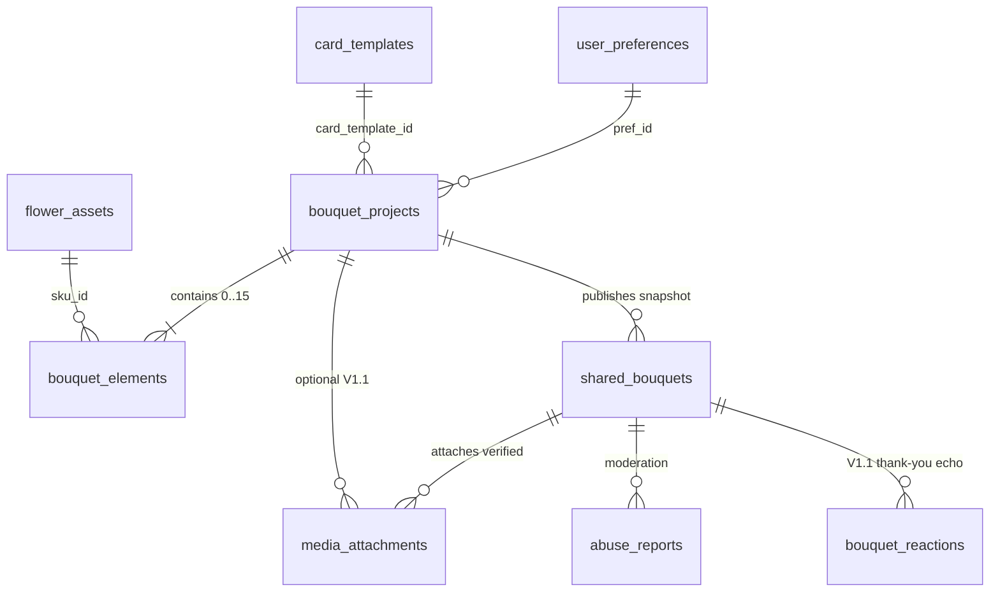

# Database Schema Specification (`database-schema.md`)

**Version:** `1.1 (Peer-Reviewed & Hardened — LibSQL / SQLite via Drizzle ORM)`  
**ORM & Dialect:** `drizzle-orm/sqlite-core` backed by `@libsql/client` (`file:./data/mydigibouquet.db` in zero-daemon local/CI environments; Turso LibSQL edge/primary in production).
- **Connection Initialization (`src/db/index.ts`):** Must execute `PRAGMA foreign_keys = ON;` on **every opened SQLite/LibSQL connection** (since `foreign_keys` is connection-scoped), and execute `PRAGMA journal_mode = WAL;` conditionally on local `file:` URLs only (remote HTTP Turso skips `WAL` pragma cleanly).
- **Timestamps:** Standardized strictly to **UTC ISO-8601 strings** (`YYYY-MM-DDTHH:mm:ss.sssZ`) for deterministic chronological `<` comparisons.
- **Non-SKU Atelier Primitives:** Fixed small curated collections (`9` vessels + vector clip masks, `5` bows, `6` ribbons, `6` wax seals, `4` tabletop surfaces, `6` audio tracks, `8` occasion presets, curated gallery presets) live cleanly in typed versioned build manifests (`src/generated/catalog-manifest.ts`) rather than unnecessary relational tables.

---

## 1. Entity-Relationship Architecture

**Architectural Boundary — Editable Workspace vs. Immutable Gift Snapshot:**
- **`bouquet_projects` + `bouquet_elements`** form a normalized relational composition store when a creator persists an editable draft project across refreshes.
- **`shared_bouquets`** freezes a canonical **immutable `BouquetSceneV1` JSON snapshot** at publish time. Editing a draft project, retiring a floral colorway (`flower_assets.is_active = 0`), or tweaking templates later **never silently mutates** an already-gifted bouquet URL (`/b/[slug]`).

---

## 2. Complete Table Definitions

### 2.1 `flower_assets` (V1 Core Catalog — 28 Botanical SKUs)
Authoritative catalog metadata seeded idempotently from build-generated `src/generated/catalog-manifest.ts`. *(Note: `GET /api/bouquets/[slug]` queries `flower_assets` **ignoring `is_active = 0`** when resolving `bloomMeanings` on historical gifts.)*

| Column | SQL Type | Constraints | Purpose |
| :--- | :--- | :--- | :--- |
| `sku_id` | `TEXT` | **PK** | Canonical slug (`peony-blush`, `eucalyptus-silver`, etc.) |
| `species_slug` | `TEXT` | `NOT NULL`, `INDEX` | Species slug (`peony`, `rose`, `eucalyptus`, `babys-breath`, etc.) |
| `has_species_page` | `INTEGER` | `NOT NULL DEFAULT 0`, `CHECK(has_species_page IN (0,1))` | `1` strictly for the 12 canonical V1 `/flowers/[slug]` pages (`0` links safely to `/flowers#${sku_id}`) |
| `color_anchor` | `TEXT` | `NOT NULL` | Hash anchor matching `/flowers/[species]#color` (`white`, `blush`, `crimson`, `yellow`, `peach`, etc.) |
| `name` | `TEXT` | `NOT NULL` | Display name (*"Blush Peony"*) |
| `role` | `TEXT` | `NOT NULL`, `CHECK(role IN ('focal','filler','foliage'))` | Botanical role |
| `color_family` | `TEXT` | `NOT NULL`, `INDEX`, `CHECK(color_family IN ('crimson','blush','ivory','amber','lavender','sage'))` | Swatch filter group |
| `color_hex` | `TEXT` | `NOT NULL` | UI swatch dot color (`#E4B4B8`) |
| `meaning_short` | `TEXT` | `NOT NULL` | `<= 20` chars card/tile subtitle (*"Warmth & Honor"*) |
| `meaning_full` | `TEXT` | `NOT NULL` | Recipient `"Meaning of Your Blooms"` paragraph |
| `occasion_tags_json` | `TEXT` | `NOT NULL` | JSON array of canonical occasion slugs (`["romance","birthday"]`) |
| `thumb_path` | `TEXT` | `NOT NULL` | `/assets/v1/stems/{sku_id}/thumb.webp` (`200px`) |
| `studio_path` | `TEXT` | `NOT NULL` | `/assets/v1/stems/{sku_id}/studio.webp` (`700px`) |
| `export_path` | `TEXT` | `NOT NULL` | `/assets/v1/stems/{sku_id}/export.webp` (`1400px`) |
| `hitmask_path` | `TEXT` | `NOT NULL` | Pre-computed `160px` bitmask JSON for O(1) alpha hit-testing |
| `natural_width` | `INTEGER` | `NOT NULL` | World source width matching `export` aspect |
| `natural_height` | `INTEGER` | `NOT NULL` | World source height |
| `anchor_x` | `REAL` | `NOT NULL`, `CHECK(anchor_x >= 0.0 AND anchor_x <= 1.0)` | Normalized stem collar pivot X |
| `anchor_y` | `REAL` | `NOT NULL`, `CHECK(anchor_y >= 0.0 AND anchor_y <= 1.0)` | Normalized stem collar pivot Y |
| `min_rot_deg` | `INTEGER` | `NOT NULL DEFAULT -45` | Natural fan min rotation (`-180` if radial) |
| `max_rot_deg` | `INTEGER` | `NOT NULL DEFAULT 45` | Natural fan max rotation (`180` if radial) |
| `allow_front_drape` | `INTEGER` | `NOT NULL DEFAULT 0`, `CHECK(allow_front_drape IN (0,1))` | `1` for trailing greenery allowed over Layer 3 lip in `Cascading` |
| `is_active` | `INTEGER` | `NOT NULL DEFAULT 1`, `CHECK(is_active IN (0,1))` | Soft picker availability switch (`1` active / `0` retired) |
| `sort_order` | `INTEGER` | `NOT NULL DEFAULT 0` | Studio grid deterministic ordering |
| `created_at` | `TEXT` | `NOT NULL` | UTC ISO-8601 timestamp |

---

### 2.2 `card_templates` (V1 Core Stationery Styles — 6 Themes)

| Column | SQL Type | Constraints | Purpose |
| :--- | :--- | :--- | :--- |
| `template_id` | `TEXT` | **PK** | `botanical-cream \| pressed-linen \| midnight-velvet \| deckle-cotton \| blush-parchment \| minimalist-editorial` |
| `name` | `TEXT` | `NOT NULL` | UI label (*"Midnight Velvet"*) |
| `surface_hex` | `TEXT` | `NOT NULL` | Primary card background (`#232824`) |
| `ink_polarity` | `TEXT` | `NOT NULL`, `CHECK(ink_polarity IN ('light_surface','dark_surface'))` | Base text polarity |
| `allowed_tints_json` | `TEXT` | `NOT NULL` | Allowed `paperTintId[]` (locks `Midnight Velvet` safely to `["charcoal"]`) |
| `default_font_pairing` | `TEXT` | `NOT NULL` | `editorial-serif \| calligraphic \| warm-literary \| modern-atelier` |
| `default_wax_seal` | `TEXT` | `NOT NULL` | Default 1 of 6 `WaxSealColorId` values |
| `card_texture_path` | `TEXT` | `NOT NULL` | Tiled paper grain WebP (`<10 KB`) |
| `envelope_closed_path` | `TEXT` | `NOT NULL` | Closed envelope visual `/assets/v1/stationery/envelopes/{id}-closed.webp` |
| `envelope_open_path` | `TEXT` | `NOT NULL` | Open flap visual `/assets/v1/stationery/envelopes/{id}-open.webp` |
| `is_active` | `INTEGER` | `NOT NULL DEFAULT 1`, `CHECK(is_active IN (0,1))` | Feature flag toggle |
| `sort_order` | `INTEGER` | `NOT NULL DEFAULT 0` | Display order |

---

### 2.3 `user_preferences` (V1 Anonymous Studio Preferences)
Zero mandatory login; keyed strictly to a signed `HttpOnly` anonymous device ID cookie + mirrored in `localStorage`.

| Column | SQL Type | Constraints | Purpose |
| :--- | :--- | :--- | :--- |
| `pref_id` | `TEXT` | **PK** | UUID v4 |
| `client_token_hash` | `TEXT` | `UNIQUE NOT NULL` | SHA-256 hash of anonymous browser cookie token |
| `table_surface_id` | `TEXT` | `NOT NULL DEFAULT 'linen'`, `CHECK(table_surface_id IN ('linen','limewash','travertine','slate'))` | Default tabletop surface |
| `default_show_colophon` | `INTEGER` | `NOT NULL DEFAULT 1`, `CHECK(default_show_colophon IN (0,1))` | Remembers PNG colophon toggle |
| `preferred_audio_muted` | `INTEGER` | `NOT NULL DEFAULT 0`, `CHECK(preferred_audio_muted IN (0,1))` | Audio preview mute state |
| `reduced_motion_override` | `TEXT` | `NOT NULL DEFAULT 'system'`, `CHECK(reduced_motion_override IN ('system','reduce'))` | Motion setting |
| `updated_at` | `TEXT` | `NOT NULL` | UTC ISO-8601 timestamp |

---

### 2.4 `bouquet_projects` (Saved Editable Projects / Drafts)
Persisted server-side when a creator saves a server project (`POST /api/projects`, `0..15` stems allowed for works-in-progress) keyed strictly by unguessable `edit_token_hash`.

| Column | SQL Type | Constraints | Purpose |
| :--- | :--- | :--- | :--- |
| `id` | `TEXT` | **PK** | UUID v4 |
| `edit_token_hash` | `TEXT` | `UNIQUE NOT NULL` | SHA-256 digest of 32-byte creator secret token |
| `pref_id` | `TEXT` | `FK -> user_preferences.pref_id ON DELETE SET NULL`, nullable | Optional link to creator preferences |
| `schema_version` | `INTEGER` | `NOT NULL DEFAULT 1` | Scene format version (`1`) |
| `title` | `TEXT` | `NOT NULL DEFAULT 'Untitled Bouquet'` | Optional sender project label (`<= 60` chars) |
| `occasion_tag` | `TEXT` | nullable, `CHECK(occasion_tag IS NULL OR occasion_tag IN ('birthday','anniversary','romance','apology','thank-you','sympathy','miss-you','get-well'))` | Canonical occasion slug |
| `vessel_id` | `TEXT` | `NOT NULL` | One of 9 allowlisted vessels |
| `bow_style_id` | `TEXT` | `NOT NULL`, `CHECK(bow_style_id IN ('double-bow','silk-tails','minimal-knot','wax-band','none'))` | Bow style ID |
| `ribbon_color_id` | `TEXT` | `NOT NULL` | One of 6 ribbon colors |
| `stem_visibility` | `TEXT` | `NOT NULL`, `CHECK(stem_visibility IN ('tucked','exposed','submerged'))` | Stem visibility mode |
| `table_surface_id` | `TEXT` | `NOT NULL`, `CHECK(table_surface_id IN ('linen','limewash','travertine','slate'))` | Tabletop surface |
| `arrangement_template` | `TEXT` | `NOT NULL`, `CHECK(arrangement_template IN ('classic-round','airy-garden','cascading','minimalist'))` | Arrangement template |
| `card_template_id` | `TEXT` | `NOT NULL FK -> card_templates.template_id ON DELETE RESTRICT` | Canonical authoritative `CardConfig.templateId` (no duplicate drift) |
| `card_config_json` | `TEXT` | `NOT NULL` | Remaining sanitized `CardConfig` fields (`envelopeId`, `waxSealColorId`, `fontPairingId`, alignment, tints, names, message, audio) |
| `show_colophon` | `INTEGER` | `NOT NULL DEFAULT 1`, `CHECK(show_colophon IN (0,1))` | Maps cleanly to `BouquetSceneV1.showColophon` |
| `hide_names_in_preview` | `INTEGER` | `NOT NULL DEFAULT 0`, `CHECK(hide_names_in_preview IN (0,1))` | Maps cleanly to `BouquetSceneV1.hideNamesInPreview` |
| `status` | `TEXT` | `NOT NULL DEFAULT 'draft'`, `CHECK(status IN ('draft','published','archived'))` | Flips to `'published'` atomically via `POST /api/bouquets` so `>90d` draft cleanup never deletes published project lineage |
| `created_at` | `TEXT` | `NOT NULL` | UTC ISO-8601 |
| `updated_at` | `TEXT` | `NOT NULL`, `INDEX` | Used for `status = 'draft'` `> 90 days` pruning |

---

### 2.5 `bouquet_elements` (Normalized Stems Per Project)

| Column | SQL Type | Constraints | Purpose |
| :--- | :--- | :--- | :--- |
| `id` | `TEXT` | **PK** | UUID v4 matching client `StemInstance.id` |
| `project_id` | `TEXT` | `NOT NULL FK -> bouquet_projects.id ON DELETE CASCADE`, `INDEX` | Owning project |
| `sku_id` | `TEXT` | `NOT NULL FK -> flower_assets.sku_id ON DELETE RESTRICT`, `INDEX` | Botanical SKU reference |
| `x` | `REAL` | `NOT NULL`, `CHECK(x >= 140 AND x <= 860)` | Canonical collar-pivot X coordinate |
| `y` | `REAL` | `NOT NULL`, `CHECK(y >= 110 AND y <= 840)` | Canonical focal/pivot Y coordinate (stems extend visually to `950` below collar in `exposed` mode) |
| `scale` | `REAL` | `NOT NULL`, `CHECK(scale >= 0.65 AND scale <= 1.45)` | Scale multiplier |
| `rotation_deg` | `REAL` | `NOT NULL`, `CHECK(rotation_deg >= -180 AND rotation_deg <= 180)` | Stem angle |
| `flipped_x` | `INTEGER` | `NOT NULL DEFAULT 0`, `CHECK(flipped_x IN (0,1))` | Horizontal mirror |
| `z_index` | `INTEGER` | `NOT NULL`, `CHECK(z_index >= 0 AND z_index <= 14)` | Contiguous layer index `[0..14]` |

- **Unique Composite Index:** `CREATE UNIQUE INDEX uq_elements_project_z ON bouquet_elements(project_id, z_index);` (enforces non-colliding z-layer ordering; `PUT /api/projects/[id]` deletes & inserts contiguous ordered elements inside a single transaction).

---

### 2.6 `shared_bouquets` (V1 Core Shareable Records — Immutable Gift Links)

| Column | SQL Type | Constraints | Purpose |
| :--- | :--- | :--- | :--- |
| `slug` | `TEXT` | **PK** | 12-char CSPRNG base62 identifier (`/b/[slug]`, ~71.4 bits entropy) |
| `source_project_id` | `TEXT` | `FK -> bouquet_projects.id ON DELETE SET NULL`, nullable | Lineage trace if originated from saved project |
| `receipt_token_hash` | `TEXT` | `UNIQUE NOT NULL` | SHA-256 digest of creator read-receipt token (`/receipt/[token]` V1.1) |
| `schema_version` | `INTEGER` | `NOT NULL DEFAULT 1` | Scene snapshot version |
| `bouquet_snapshot_json` | `TEXT` | `NOT NULL` | Complete validated immutable `BouquetSceneV1` JSON (`<= 32 KB` raw body) |
| `og_image_key` | `TEXT` | `NOT NULL` | Verified storage key `og/{slug}.jpg` (`1200×630` `< 300 KB`) |
| `hide_names_in_preview` | `INTEGER` | `NOT NULL DEFAULT 0`, `CHECK(hide_names_in_preview IN (0,1))` | Redacts names from OG & sealed arrival state |
| `has_pin` | `INTEGER` | `NOT NULL DEFAULT 0`, `CHECK(has_pin IN (0,1))` | V1.1 gate flag (`0` in V1) |
| `pin_hash` | `TEXT` | nullable | Salted async `scrypt` (`saltHex:hashHex`, `N=16384, r=8, p=1`) PIN hash (V1.1) |
| `moderation_status` | `TEXT` | `NOT NULL DEFAULT 'active'`, `INDEX`, `CHECK(moderation_status IN ('active','flagged','hidden','deleted'))` | Lifecycle status |
| `abuse_report_count` | `INTEGER` | `NOT NULL DEFAULT 0`, `CHECK(abuse_report_count >= 0)` | `>= 3` sets `'flagged'`; `>= 5` distinct verified IP/subnet flags auto-transitions `'hidden'` + purges `og/{slug}.jpg` |
| `view_count` | `INTEGER` | `NOT NULL DEFAULT 0`, `CHECK(view_count >= 0)` | Incremented strictly via interactive tap beacon (`POST /api/bouquets/[slug]/open`), never bots or sender Preview |
| `first_opened_at` | `TEXT` | nullable | UTC ISO-8601 timestamp of first real recipient envelope tap |
| `created_at` | `TEXT` | `NOT NULL`, `INDEX` | UTC ISO-8601 publish timestamp |

---

### 2.7 `media_attachments` (V1.1 Optional Polaroid Photos & Voice Messages)

| Column | SQL Type | Constraints | Purpose |
| :--- | :--- | :--- | :--- |
| `id` | `TEXT` | **PK** | UUID v4 |
| `project_id` | `TEXT` | `FK -> bouquet_projects.id ON DELETE SET NULL`, nullable, `INDEX` | Temporary draft binding |
| `share_slug` | `TEXT` | `FK -> shared_bouquets.slug ON DELETE CASCADE`, nullable, `INDEX` | Published gift binding (`max 3 photos + 1 voice` enforced server-side) |
| `uploader_token_hash` | `TEXT` | `NOT NULL` | SHA-256 hash authorizing attaching uploaded media to `POST /api/bouquets` |
| `media_type` | `TEXT` | `NOT NULL`, `CHECK(media_type IN ('photo','voice'))` | Media category |
| `object_key` | `TEXT` | `UNIQUE NOT NULL` | Extension matched strictly to verified MIME (`media/photos/{uuid}.{webp\|jpg}` or `media/voice/{uuid}.{m4a\|mp3\|webm}`) |
| `mime_type` | `TEXT` | `NOT NULL`, `CHECK(mime_type IN ('image/webp','image/jpeg','audio/mp4','audio/mpeg','audio/webm'))` | Server-verified MIME |
| `byte_size` | `INTEGER` | `NOT NULL` | Exact verified bytes (`<= 2097152` photo / `<= 4194304` voice) |
| `duration_ms` | `INTEGER` | nullable, `CHECK(duration_ms IS NULL OR (duration_ms > 0 AND duration_ms <= 45000))` | Audio cap `<= 45s` |
| `width` | `INTEGER` | nullable | Verified pixel width (`<= 1600`) |
| `height` | `INTEGER` | nullable | Verified pixel height (`<= 1600`) |
| `exif_stripped` | `INTEGER` | `NOT NULL DEFAULT 1`, `CHECK(exif_stripped IN (0,1))` | Unconditionally re-encoded via `sharp` without metadata |
| `moderation_status` | `TEXT` | `NOT NULL DEFAULT 'active'`, `CHECK(moderation_status IN ('active','deleted'))` | Status |
| `orphan_expires_at` | `TEXT` | **NULLABLE**, `INDEX` | UTC ISO-8601 `+24h` when uploaded; set to **`NULL`** atomically once bound to `shared_bouquets` |
| `created_at` | `TEXT` | `NOT NULL` | UTC ISO-8601 |

---

### 2.8 `abuse_reports` & `bouquet_reactions` (Moderation V1 + Echo V1.1)

- **`abuse_reports` (V1 Core):**
  - `id` (`TEXT PK`), `share_slug` (`TEXT NOT NULL FK -> shared_bouquets.slug ON DELETE CASCADE`), `reason` (`TEXT NOT NULL CHECK(reason IN ('harassment','spam','inappropriate','other'))`), `details` (`TEXT` max 500 chars), **`reporter_ip_hash` (`TEXT NOT NULL`)** computed using keyed **`HMAC-SHA256(SERVER_IP_PEPPER, trustedClientIp)`** so `2^32` IPv4 scans cannot reverse reporter IPs, `created_at` (`TEXT NOT NULL`).
  - **Unique Dedupe Index:** `CREATE UNIQUE INDEX uq_report_slug_ip ON abuse_reports(share_slug, reporter_ip_hash);`
- **`bouquet_reactions` (V1.1 Recipient Thank-You Echo):**
  - `id` (`TEXT PK`), `share_slug` (`TEXT NOT NULL FK -> shared_bouquets.slug ON DELETE CASCADE`, `UNIQUE`), `emoji_code` (`TEXT NOT NULL CHECK(emoji_code IN ('heart','hug','smile','tears'))`), `reply_note` (`TEXT`, max 140 graphemes), `created_at` (`TEXT NOT NULL`).

---

## 3. Migrations & Retention

1. **Migrations:** Generated declaratively via `drizzle-kit generate` into `drizzle/migrations/`.
2. **Retention Sweeps:**
   - Unpublished `bouquet_projects` where **`status = 'draft'`** and `updated_at < now - 90 days` prune cleanly (`CASCADE` removes `bouquet_elements`). Published projects (`status = 'published'`) are retained for share lineage.
   - Orphaned V1.1 `media_attachments` where `orphan_expires_at IS NOT NULL AND orphan_expires_at < now_iso` delete storage blobs before pruning DB rows.
